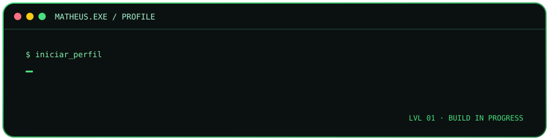

# Matheus da Silva de Lima

**Estudante de Engenharia de Software · Desenvolvedor em formação**

---

## Sobre mim

- 🎓 Cursando **Engenharia de Software** na UNIFAN.
- 🐍 Estudando **Python** e fundamentos de programação.
- 🗄️ Desenvolvendo minha base em **SQL** e análise de dados.
- 🧰 Aprendendo a utilizar Git e GitHub para organizar meus estudos e projetos.
- 🎯 Buscando evoluir por meio de prática constante e projetos próprios.

## Tecnologias em estudo

## Objetivo atual

Consolidar a lógica de programação, escrever código mais organizado e construir projetos que demonstrem minha evolução em Python e SQL.

## Estatísticas do GitHub

---

*Em construção — aprendendo, praticando e evoluindo um commit por vez.*

