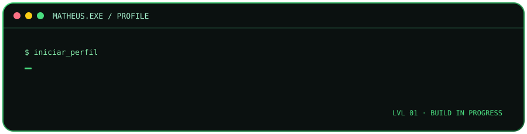

# Matheus | Engenharia de Software

**Estudante de Engenharia de Software · Desenvolvedor em formação**

---

## Sobre mim

Sou estudante de **Engenharia de Software na UNIFAN**. Uso este espaço para registrar minha evolução, praticar programação e desenvolver projetos enquanto fortaleço minha base em tecnologia.

Atualmente, estou construindo meus conhecimentos em programação, banco de dados e análise de dados. Meu objetivo é transformar o aprendizado em projetos práticos e conquistar uma oportunidade de estágio em TI.

## Painel de desenvolvimento

| Área | Nível atual | Em foco |
|:--|:--:|:--|
| Python | Iniciante | Funções, lógica e organização do código |
| SQL | Em estudo | Consultas e fundamentos de banco de dados |
| Excel | Fundamentos | Fórmulas e organização de dados |
| Git e GitHub | Em aprendizado | Versionamento e documentação |
| C | Iniciante | Fundamentos de programação |
| Inteligência Artificial | Em aprendizado | Fundamentos e aplicações práticas |

Os níveis são autoavaliações do meu momento de aprendizagem. Não representam certificações ou experiência profissional.

## Tecnologias e ferramentas

## Projetos em destaque

| Projeto | O que estou praticando |
|:--|:--|
| [Calculadora em Python](https://github.com/Matheus-pixe/Estudo-software/tree/main/projetos/calculadora) | Operações matemáticas, funções e validação de entradas |
| [Controle de ponto](https://github.com/Matheus-pixe/Estudo-software/tree/main/projetos/controle_ponto) | Planejamento de sistema e estrutura de dados SQL |
| [Análise de vendas](https://github.com/Matheus-pixe/Estudo-software/tree/main/projetos/analise_dados) | Preparação para práticas de análise de dados |
| [Caderno de estudos](https://github.com/Matheus-pixe/Estudo-software) | Exercícios, anotações e estudos de programação |

## Estatísticas do GitHub

## Próximos passos

- [ ] Fortalecer a lógica de programação e a resolução de problemas.
- [ ] Praticar Python com projetos cada vez mais organizados.
- [ ] Consolidar SQL e fundamentos de banco de dados.
- [ ] Avançar em Excel e iniciar Power BI.
- [ ] Documentar projetos e preparar meu portfólio para oportunidades de estágio.

---

**Aprender · Praticar · Construir · Evoluir**

Este perfil está em constante atualização, assim como meus estudos.

